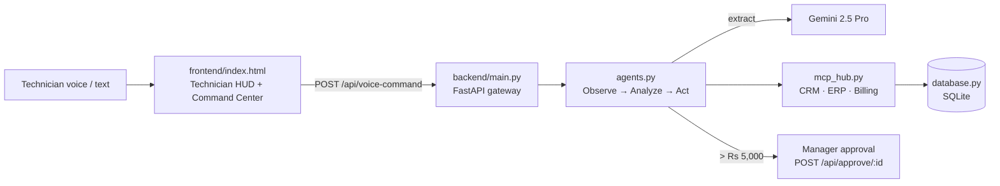

# TRINETRA VoiceOps AI

**Team TRINESH** · Build with Google Gemini · Track: *Voice-Driven Agentic Workflow Automation*

A field technician finishes a repair and just *says* it. A swarm of agents updates the CRM,
deducts van stock, asks a manager to approve high-value parts, and closes the ticket with an invoice.
No forms, no typing.

> "Customer 102 ka AC repair completed. Replaced the rotary compressor, serial number DKN-99421."

## The Three Eyes (Trinetra)

| Eye | Role | In this repo |
|---|---|---|
| **Vision – Observe** | Hear and understand the technician | Browser speech input + Gemini structured extraction (`agents.py`) |
| **Wisdom – Analyze** | Reason over parts, warranty and policy | Gemini 2.5 Pro parsing, clarification loop, task planning |
| **Transformation – Act** | Execute across enterprise systems | 8-agent swarm calling the MCP hub (`mcp_hub.py`) |

## Architecture



## Repository layout

```
trinetra-voiceops-ai/
├── README.md
├── .gitignore  .dockerignore  .env.example
├── docs/TRINETRA_Pitch_Deck.pdf
├── frontend/index.html        # Technician HUD + Command Center (Tailwind, no build step)
└── backend/
    ├── Dockerfile
    ├── requirements.txt
    ├── main.py                # FastAPI app, routes, serves the frontend
    ├── database.py            # SQLite persistence (swap point for Firestore)
    ├── mcp_hub.py             # CRM / ERP / Billing connectors
    └── agents.py              # Gemini extraction + 8-agent swarm
```

## Quick start (local)

```bash
git clone <your-repo-url> && cd trinetra-voiceops-ai/backend
python -m venv .venv && source .venv/bin/activate      # Windows: .venv\Scripts\activate
pip install -r requirements.txt

cp ../.env.example ../.env     # optional: add GEMINI_API_KEY for live Gemini
python main.py                 # → http://localhost:8000
```

No API key? It still works: a built-in demo parser handles the three preset scenarios.
Get a key at <https://aistudio.google.com/apikey>.

## Demo script (≈ 2 minutes)

1. **Missing serial** → agent asks for the compressor serial number (clarification loop).
2. **With serial** → CRM updated, van stock 1 → 0 with auto-PO, part value Rs 14,500 exceeds the
   Rs 5,000 limit, so closure pauses for a **manager approval** card. Click *Approve*.
3. **Auto-approve** ("Customer 105 … two capacitors") → no approval needed; invoice sent, ticket closed.
4. *Reset Demo State* to run it again.

## API

| Method | Path | Purpose |
|---|---|---|
| GET | `/` | Web UI |
| GET | `/health` | Liveness probe |
| GET | `/api/dashboard` | Tickets, van stock, workflows |
| POST | `/api/voice-command` | `{"transcript": "..."}` → run the swarm |
| POST | `/api/approve/{trace_id}` | Manager approval (404 unknown, 409 not pending) |
| POST | `/api/reset-demo` | Reseed demo data |

Interactive docs: `http://localhost:8000/docs`.

## Configuration

| Variable | Default | Notes |
|---|---|---|
| `GEMINI_API_KEY` | – | Unset → demo parser |
| `GEMINI_MODEL` | `gemini-2.5-pro` | |
| `APPROVAL_THRESHOLD_INR` | `5000` | HITL threshold |
| `DB_PATH` | `backend/trinetra_enterprise.db` | `/tmp/...` in the container |
| `PORT` | `8000` local / `8080` Cloud Run | |

## Docker & Google Cloud Run

Build from the **repo root** (the image needs both `backend/` and `frontend/`):

```bash
docker build -f backend/Dockerfile -t trinetra-voiceops-ai .
docker run -p 8080:8080 -e GEMINI_API_KEY=... trinetra-voiceops-ai   # http://localhost:8080

# Cloud Run
PROJECT=<your-project-id>; REGION=asia-south1
docker tag trinetra-voiceops-ai $REGION-docker.pkg.dev/$PROJECT/trinetra/app:v1
docker push $REGION-docker.pkg.dev/$PROJECT/trinetra/app:v1
gcloud run deploy trinetra-voiceops-ai \
  --image $REGION-docker.pkg.dev/$PROJECT/trinetra/app:v1 \
  --region $REGION --allow-unauthenticated --max-instances 1 \
  --set-secrets GEMINI_API_KEY=gemini-api-key:latest
```

`--max-instances 1` matters: SQLite lives on the instance's ephemeral disk, so data resets on
restart and is not shared between instances. That is fine for a demo; use Firestore for production.

## What is real vs. simulated in this prototype

| Capability | Status |
|---|---|
| Gemini structured extraction (Hinglish → parts/SKUs/serial) | **Real** when `GEMINI_API_KEY` is set |
| Voice in/out | Browser Web Speech API (Chrome/Edge). Gemini Live API is the planned upgrade |
| Clarification loop, approval gate, stock deduction, audit hash (SHA-256) | **Real** logic over SQLite |
| CRM / ERP / billing connectors | In-process stand-ins shaped like MCP tools |
| Voiceprint verification, WhatsApp delivery, auto-PO | **Simulated** (log messages only) |

## Push to GitHub

```bash
git init && git add . && git commit -m "TRINETRA VoiceOps AI: initial commit"
git branch -M main
git remote add origin https://github.com/<you>/trinetra-voiceops-ai.git
git push -u origin main
```
Never commit `.env` (it is git-ignored). Rotate any API key that was ever pasted into source code.
